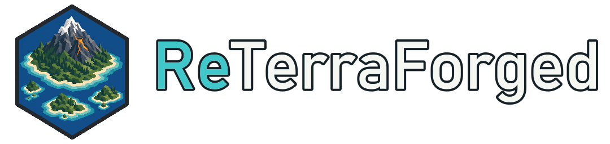

# ReTerraForged

Terrain generation for Minecraft 1.21.1 on NeoForge and Fabric.

## 0.0.7

- Restores wetland valley and pool shaping with a gradual mountain-edge fade. Both default presets give each eligible river segment a 50% chance to generate a wetland.
- Structure searches no longer build a terrain tile for an uncached one-column height probe. Cached probes and normal structure generation keep using the terrain tile path.

## Island generation

- Optional archipelagos with configurable density, size, height, and terrain scale.
- Dedicated island mountains and volcano-shaped peaks.
- Adjustable offshore depth, beach width, beach coverage, and coast transitions.
- Island-aware climate routing and beach-biome selection that avoids stone-shore dominance.
